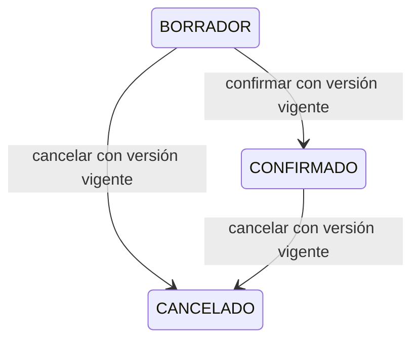

# Mantener historial y transiciones dentro de una transacción

[Unidad](README.md) · [Laboratorio](LABORATORIO.md) · [Práctica](PRACTICA.md) · [Solución](SOLUCIONES.md)

## 1. Ubica el proyecto y la fuente

Sigue [ejemplos/api-productos/src/main/java/com/lelyliliana/productos/PedidoService.java](../ejemplos/api-productos/src/main/java/com/lelyliliana/productos/PedidoService.java) en el proyecto indicado por esta unidad. La [ruta progresiva](../docs/RUTA_PROGRESIVA.md) explica qué cambia de una etapa a otra; los comandos del laboratorio parten de la raíz del curso.

## 2. Recorre las decisiones

Un pedido se crea BORRADOR con detalles únicos por producto, cantidades entre 1 y 10000 y un máximo de 50. Todavía no tiene precio unitario histórico; el total inicial es 0.00. La confirmación captura el precio actual del catálogo en cada detalle.

Si creas con precio 10, cambias catálogo a 15 y confirmas dos unidades, el total es 30. Cambiar después a 99 no reescribe ese historial. Es una regla de esta referencia, no la suposición de que el precio se congeló al crear el borrador.

PedidoService rodea confirmación con una transacción. Pedido.confirmar puede haber cambiado un detalle antes de encontrar otro producto inactivo; el rollback de la transacción revierte esos cambios persistidos. La función de dominio por sí sola no promete atomicidad de cualquier objeto en memoria fuera de ese límite.

El comando recibe versión vigente. Se rechaza un número antiguo y @Version protege el cambio concurrente en la base. Cancelar conserva historial si ya estaba confirmado; un cancelado no se confirma. La FK impide borrar productos referenciados y eliminar un pedido no elimina el producto compartido.

## 3. Contrasta el comportamiento

Repite la secuencia 10→15→confirmar 30→catálogo 99→historial 30. Cancela con la versión vigente e intenta confirmar el cancelado. Ejecuta la prueba de rollback y la de dos confirmaciones concurrentes para observar límites que una sola petición normal no demuestra.

## 4. Repite un recorrido ejecutable

Después de construir el JAR de esta etapa según [LABORATORIO.md](LABORATORIO.md), ejecuta:

```text
python scripts/recorridos.py --etapa integrado
```

El programa arranca su propio proceso local con puerto temporal y datos ficticios, comprueba resultados y lo detiene al terminar. Observa los casos de esta unidad y relaciona cada expectativa con el archivo real. Para temas de diseño o medición, el recorrido funcional complementa la actividad; no sustituye una migración, benchmark o prueba de infraestructura que no se ejecutó.

[Intentar la práctica](PRACTICA.md) · [Contrastar la solución](SOLUCIONES.md)

## Transiciones admitidas



CONFIRMADO conserva precio capturado; CANCELADO no tiene una transición de vuelta a confirmación en esta API. El control de versión y la transacción se verifican además del estado.

---

### ¿Necesitas apoyo con este tema?

Si te bloqueaste con la práctica, necesitas revisar tu entorno o adaptar lo aprendido a tu proyecto, podemos trabajarlo en una sesión personalizada.

[**Solicitar asesoría para este tema por WhatsApp**](https://wa.me/573103618296?text=Hola%2C%20Leli.%20Estoy%20estudiando%20Unidad%2030%20%E2%80%94%20Proyecto%20final%20del%20curso%20Spring%20Boot%20y%20APIs%20REST%20%28https%3A%2F%2Fgithub.com%2Flelyliliana%2FCurso-Spring-Boot%2Ftree%2Fmain%2Funidad30-proyecto-final%29%20y%20necesito%20una%20asesor%C3%ADa%20personalizada.%20Mi%20duda%20es%E2%80%A6)
